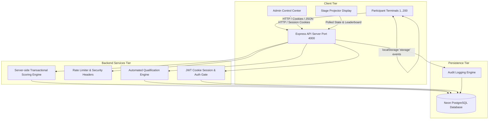
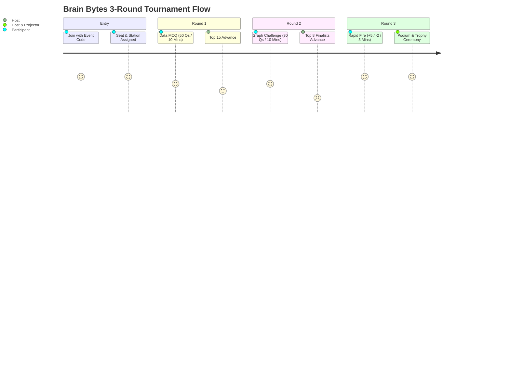
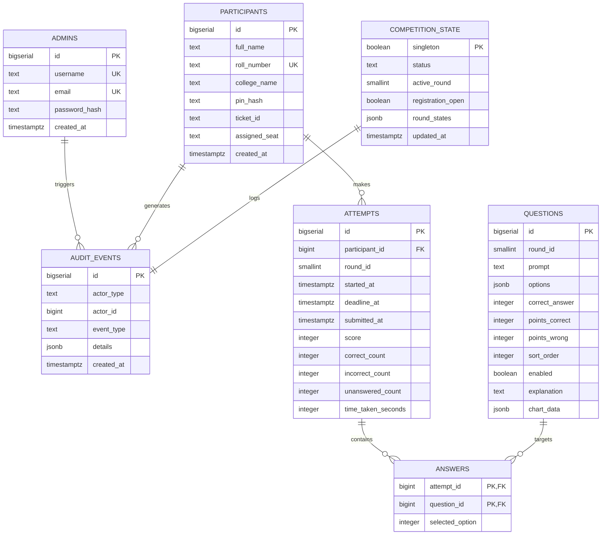

# Brain Bytes: Complete Technical & Operational Documentation
**Event:** Data Mania 2026 — Brain Bytes Competition
**System Version:** 1.0.0 (Production Architecture)
**Last Updated:** October 2026

---

## Table of Contents
1. [Executive Summary & Purpose](#1-executive-summary--purpose)
2. [High-Level System Architecture](#2-high-level-system-architecture)
3. [Technology Stack & Infrastructure](#3-technology-stack--infrastructure)
4. [Tournament Structure & Gameplay Mechanics](#4-tournament-structure--gameplay-mechanics)
   - [Round 1: Data MCQ (Foundations & SQL)](#round-1-data-mcq)
   - [Round 2: Graph Challenge (Visual Data Interpretation)](#round-2-graph-challenge)
   - [Round 3: Rapid Fire (Live Stage Finale)](#round-3-rapid-fire)
5. [Database Architecture & Schema Specification](#5-database-architecture--schema-specification)
   - [Entity Relationship Details](#entity-relationship-details)
   - [Migration History](#migration-history)
6. [API Specification & Endpoints](#6-api-specification--endpoints)
   - [System & Health](#system--health)
   - [Authentication & Identity](#authentication--identity)
   - [Participant Operations](#participant-operations)
   - [Competition & Round Execution](#competition--round-execution)
   - [Admin Control Endpoints](#admin-control-endpoints)
7. [Frontend Architecture & User Interfaces](#7-frontend-architecture--user-interfaces)
   - [Participant Portal & Credential Gate](#participant-portal--credential-gate)
   - [Round Exam Arenas & Anti-Cheat Engine](#round-exam-arenas--anti-cheat-engine)
   - [SVG Chart Rendering Engine (GraphVisualizer)](#svg-chart-rendering-engine-graphvisualizer)
   - [Admin Control Center (8 Modules)](#admin-control-center-8-modules)
   - [Auditorium Projector Display](#auditorium-projector-display)
8. [Anti-Cheat & Proctoring Engine](#8-anti-cheat--proctoring-engine)
9. [State Synchronization & Real-Time Flow](#9-state-synchronization--real-time-flow)
10. [Configuration & Environment Variables](#10-configuration--environment-variables)
11. [Installation, Seeding & Deployment Guide](#11-installation-seeding--deployment-guide)
12. [Repository Directory & File Layout](#12-repository-directory--file-layout)
13. [Verification, Testing & Release Status](#13-verification-testing--release-status)

---

## 1. Executive Summary & Purpose

**Brain Bytes** is an event-grade, real-time competition platform engineered for **Data Mania 2026**. It hosts 100 to 200+ concurrent competitors through a three-stage progressive elimination tournament testing core database engineering, quantitative analysis, visual data comprehension, and high-pressure algorithmic problem-solving.

### Core Objectives
* **Strict Authoritative Integrity:** Scoring, answer validation, and time deadlines are strictly computed server-side in Neon PostgreSQL transactions. **Caveat:** the frontend bundle still imports `src/data/round*Questions.ts`, which contain `correctAnswer` and `explanation`, so answer keys currently ship to the browser (see `docs/CODE_REVIEW.md`).
* **Progressive Qualification:** Automated qualification algorithms advance the highest-scoring verified participants across rounds with instant tie-breaking by elapsed completion seconds.
* **Resilient State Recovery:** Participant station assignments, active timer deadlines, and recorded answers survive page reloads, browser restarts, and temporary network dropouts.
* **Zero Disruption for Hosts:** An extensive 8-module Admin Control Center enables stage marshals to unlock rounds, broadcast alerts, proctor live stations, adjust qualification quotas, and stream an auditorium projector scoreboard.

---

## 2. High-Level System Architecture

The system follows a modern decoupled architecture:



---

## 3. Technology Stack & Infrastructure

### Frontend Client
* **Framework:** React 19 (`^19.2.8`) with TypeScript (`~6.0.2`)
* **Build Tooling:** Vite 8 (`^8.3.0`)
* **Styling System:** Handcrafted Vanilla CSS with CSS custom properties (`index.css`, `App.css`, `AdminControlCenter.css`, `Round1MCQ.css`). Custom dark aesthetic featuring obsidian palettes (`#0A0D14`, `#111622`) and molten crimson accents (`#8E233B`, `#B94B68`, `#FF4D6D`).
* **Visualizations:** Native pure SVG chart components (`GraphVisualizer.tsx`) with zero heavy third-party plotting dependencies.
* **Networking:** Fetch wrapper with `credentials: 'include'` (`apiClient.ts`).
* **State & Synchronization:** Unified in-memory state with cross-tab `storage`/`bb_storage_sync` window events (localStorage) and limited polling in the projector view (`competitionStateService.ts`).

### Backend API
* **Runtime:** Node.js 20+ (ES Modules)
* **Web Framework:** Express 5 (`^5.1.0`)
* **Database Driver:** `pg` (`^8.16.3`) with SSL pooling connected to Neon PostgreSQL
* **Security & Hardening:**
  * `helmet` (`^8.1.0`): HTTP security headers (CSP, HSTS, X-Content-Type-Options)
  * `cors` (`^2.8.5`): Strict origin validation (`FRONTEND_ORIGINS`)
  * `express-rate-limit` (`^8.1.0`): Auth brute-force protection
  * `cookie-parser` (`^1.4.7`): Encrypted HTTP-only session cookies
  * `bcryptjs` (`^3.0.2`): 12-round salted password hashing
  * `zod` (`^4.1.12`): Strict request body and param schema validation
  * `jsonwebtoken` (`^9.0.2`): Tamper-proof session signatures

---

## 4. Tournament Structure & Gameplay Mechanics



### Round 1: Data MCQ
* **Theme:** Database Management Systems (DBMS), SQL, Relational Algebra, Normalization, Indexing, and Transaction Management.
* **Questions:** Exactly 50 multiple choice questions seeded into PostgreSQL (`round_id = 1`).
* **Duration:** 10 minutes (600 seconds).
* **Scoring Rules:**
  * **Correct Answer:** `+1.00` mark
  * **Incorrect Answer:** `0.00` penalty
  * **Unanswered:** `0.00`
  * **Maximum Raw Score:** 50 marks
* **Advancement Criteria:** Host qualifies the **Top 15** highest scoring candidates (hard-coded in `AdminRoundControl.tsx`; the backend accepts 1–200 and `ROUND1_QUALIFY_COUNT` in `.env` is currently unused) using server-side score and time tie-breaking.
* **Terminal Interface:**
  * Full 50-item question navigation matrix with dynamic color indicators:
    * *Green:* Answered
    * *Purple:* Marked for Review
    * *Yellow:* Answered & Marked for Review
    * *Slate:* Visited
    * *Border Outline:* Active Question
  * Instant question jump, bookmarking, and clear response options.

### Round 2: Graph Challenge
* **Theme:** Visual data interpretation, anomaly detection, statistical distribution analysis, confusion matrices, and machine learning curves.
* **Questions:** Exactly 30 questions seeded into PostgreSQL (`round_id = 2`).
* **Duration:** 10 minutes (600 seconds).
* **Scoring Rules:**
  * **Correct Answer:** `+1.00` mark
  * **Incorrect Answer:** `0.00` penalty
  * **Unanswered:** `0.00`
  * **Maximum Raw Score:** 30 marks
* **Advancement Criteria:** Host qualifies the **Top 8 Finalists** for the championship stage.
* **Integrated Visuals:** Each question embeds a native SVG chart:
  1. *Grouped Bar Charts* (e.g., quarterly revenue, category comparisons)
  2. *Multi-Line Charts* (e.g., loss curves, temperature vs. pressure)
  3. *Scatter Plots with Outlier Highlighting* (e.g., anomaly detection)
  4. *Donut & Pie Charts* (e.g., market share distribution)
  5. *Bar and Line charts* (single series)
  6. *Confusion Matrices & ROC Curves* (e.g., precision vs. recall trade-offs)

### Round 3: Rapid Fire
* **Theme:** High-pressure live stage finale covering evaluation metrics, overfitting diagnostics, deep learning hyperparameters, and optimization edge-cases.
* **Questions:** 5 stage questions seeded into PostgreSQL (`round_id = 3`).
* **Duration:** 3 minutes (180 seconds).
* **Marking Rules (High Risk / High Reward):**
  * **Correct Answer:** `+5.00` marks
  * **Incorrect Answer:** `-2.00` marks penalty (deducted from total score)
  * **Unanswered:** `0.00` marks
* **Championship Outcome:** Cumulative score across all rounds determines the Podium Winners (Gold, Silver, Bronze) displayed live on the Stage Projector.

---

## 5. Database Architecture & Schema Specification

The database is built on PostgreSQL with strict check constraints, foreign keys, cascade policies, and index optimization.

### Entity Relationship Diagram



### Table Definitions & Constraints
1. **`admins`**: Stores credentials for competition hosts and proctors. Password hashes use bcrypt with work factor 12.
2. **`participants`**: Stores unique competitor records indexed on `roll_number` and `ticket_id`. Automatically assigns station numbers (`Station #1` – `Station #60`) and unique ticket numbers (`DM-26-XXXX`).
3. **`competition_state`**: A singleton table (guaranteed via `CHECK (singleton = TRUE)`) controlling overall status (`NOT_STARTED`, `LIVE`, `PAUSED`, `COMPLETED`), active round, registration availability, and individual round locks.
4. **`questions`**: Full question catalog with `UNIQUE(round_id, sort_order)`. Stores option arrays, correct zero-indexed choices, points, explanation text, and optional SVG `chart_data`.
5. **`attempts`**: Enforces a strict one-attempt-per-round-per-participant constraint (`UNIQUE(participant_id, round_id)`). Records starting timestamps, server deadline timestamps, submission status, and computed metrics.
6. **`answers`**: Normalized participant answer choices per question with composite primary key `(attempt_id, question_id)`.
7. **`audit_events`**: Immutable chronological audit log recording every admin login, participant registration, attempt start, submission score, qualification execution, and settings modification.

### Migration History
* `001_initial.sql`: Core schema (admins, participants, competition_state, questions, attempts, answers, audit_events) with performance indexes.
* `002_participant_auth_and_tickets.sql`: Adds `ticket_id`, `assigned_seat`, and `pin_hash` to participants with dedicated indexes.
* `003_round2_graph_questions.sql`: Adds `explanation` and `chart_data` (JSONB) columns to `questions` table for interactive SVG visualizations.

---

## 6. API Specification & Endpoints

All endpoints are hosted under `/api`. All participant and admin authenticated routes use secure HTTP-only cookies (`bb_session`, a signed JWT valid for 24h).

### Summary of REST Endpoints

| Method | Endpoint | Access Level | Description |
|---|---|---|---|
| `GET` | `/api/health` | Public | System status and database connectivity check |
| `POST` | `/api/auth/admin/login` | Public (Rate Limited) | Authenticate host using identifier and password |
| `POST` | `/api/auth/logout` | Authenticated | Destroy active session cookie |
| `GET` | `/api/auth/admin/me` | Admin | Validate current admin session |
| `POST` | `/api/participants/register` | Public (When Open) | Register or verify existing participant with join code |
| `POST` | `/api/participants/login` | Public | Participant login by roll number |
| `GET` | `/api/participants/me` | Participant | Get active participant profile, station, and attempts |
| `GET` | `/api/competition/state` | Public | Read current tournament status and round locks |
| `GET` | `/api/rounds/:roundId/questions` | Public (Unlocked) | Get questions for a round (omits answer keys & explanations) |
| `POST` | `/api/rounds/:roundId/attempts/start` | Participant | Begin timed attempt; establishes authoritative deadline |
| `POST` | `/api/attempts/:attemptId/submit` | Participant | Submit answers, calculate score in transaction, lock attempt |
| `GET` | `/api/leaderboard` | Public | Aggregated scores, round breakdowns, and elapsed time |
| `GET` | `/api/admin/participants` | Admin | Complete registry with round breakdown, accuracy, and telemetry |
| `PATCH` | `/api/admin/competition/state` | Admin | Update tournament state, active round, and round locks |
| `POST` | `/api/admin/qualify/:roundId` | Admin | Execute server-side qualification for top N candidates |
| `GET` | `/api/admin/attempts` | Admin | Detailed attempts list with submission timestamps and scores |

---

## 7. Frontend Architecture & User Interfaces

The client is organized into cohesive modules:

### 1. Participant Landing Page (`ParticipantLandingPage.tsx`)
* Displays event branding: **DATA MANIA // BRAIN BYTES**.
* Renders the 3 Round Cards with real-time status badges:
  * `ACTIVE`: Molten crimson gradient, clickable, routes to credentials/exam.
  * `LOCKED`: Dark slate border, lock icon, click produces informative modal.
  * `COMPLETED`: Shows checkmark and completion indicator.
* Top-right shortcut button directly accesses the `/admin` portal.

### 2. Credential Entry Modal (`RoundCredentialModal.tsx`)
* Validates participant entry against required fields:
  * **Full Name / Team Name** (min 2 chars)
  * **Roll Number / Student ID** (auto-uppercase normalized)
  * **Event Join Code** (`BYTE2026`, `DATAMANIA26`, or `SOLAR26`)
* Communicates directly with `POST /api/participants/register`.
* Assigns persistent Station number (e.g., `Station #14`) and Ticket ID (e.g., `DM-26-0014`).
* Enforces anti-impersonation: if a roll number exists, full name must match the registered record.

### 3. Exam Arenas
* **Round 1:** `Round1MCQ.tsx` (50 Questions, 10 min countdown, side navigation matrix).
* **Round 2:** `Round2GraphChallenge.tsx` (30 Questions, 10 min countdown, SVG graph viewer).
* **Round 3:** `Round3RapidFire.tsx` (5 Questions, 3 min countdown, high-risk marking indicator).

### 4. Native SVG Chart Visualizer (`GraphVisualizer.tsx`)
* Renders responsive SVG charts inside a `580x260` viewBox with dynamic ticks, zero external chart libraries, and custom dark mode styling:
  * Grouped Bar Charts with multi-colored series
  * Multi-Line Charts with path interpolation and point markers
  * Scatter Plots with labeled outlier points
  * Donut / Pie Charts with calculated arcs
  * Custom tick generation and zero-axis baselines

### 5. Admin Control Center (`AdminDashboard.tsx`)
Divided into 8 operational tabs:
1. **Overview:** Tournament heartbeat, participant counter, round progress, quick status toggles.
2. **Round Control:** Global state selector (NOT_STARTED, LIVE, PAUSED, COMPLETED), individual round activation/lock controls, one-click automated qualification runners.
3. **Participants:** Filterable and searchable registry displaying Roll Number, Station, Status (Registered, In-Progress, Completed), Accuracy %, Solved Counts, and Round scores.
4. **Question Bank:** View and verify all questions, options, point values, and chart previews across Rounds 1, 2, and 3.
5. **Live Leaderboard:** Real-time ranks, round scores, tie-breakers, and qualification status tags.
6. **Projector Display:** Dedicated presentation mode for auditorium screens.
7. **Results & Reports:** Exportable summary of performance metrics, difficulty diagnostics, and completion percentages.
8. **Settings:** Join code configuration, registration toggle, and emergency reset controls.

---

## 8. Anti-Cheat & Proctoring Engine

**Implemented (server-side):**

1. **Server deadline check:** `POST /attempts/:id/submit` rejects submissions later than `deadline_at + 15s` (HTTP 409).
2. **Transaction locking:** submit runs in a transaction with `SELECT ... FOR UPDATE`; a second submission returns the stored result (`alreadySubmitted: true`).
3. **One attempt per round:** `UNIQUE(participant_id, round_id)`.
4. **Scoring on the server:** the score returned to the client is computed from the `questions` table.

**NOT implemented (earlier drafts of this document wrongly claimed these):**

- No fullscreen enforcement, tab-blur/visibility tracking, or right-click/DevTools blocking exists in the participant arenas (only the projector view calls `requestFullscreen`).
- The "tab focus %", "ping" and "confidence" values shown in the admin participant registry are hard-coded constants returned by `GET /admin/participants`, not real telemetry.
- The client timer is derived from localStorage, not from the server `deadline_at` (see `docs/CODE_REVIEW.md`).

---

## 9. State Synchronization & Real-Time Flow

Brain Bytes combines three complementary synchronization mechanisms:

1. **Transactional PostgreSQL State:** The single source of truth for all scores, attempt statuses, and competition locks.
2. **Cross-tab localStorage events:** the frontend dispatches `bb_storage_sync` and listens to `storage` events to sync tabs on the same machine. This state is browser-local and is NOT shared between devices.
3. **Automatic Rehydration on Navigation:** When participants load any page or switch views, `App.tsx` rehydrates state from `/api/participants/me` and `/api/competition/state`.

---

## 10. Configuration & Environment Variables

### Backend Configuration (`backend/.env`)
```bash
# Environment Mode
NODE_ENV=development

# Server Port
PORT=4000

# Neon PostgreSQL Database Connection (SSL Required)
DATABASE_URL=postgresql://<user>:<password>@<host>/<database>?sslmode=require&channel_binding=require

# Session Secret (Minimum 32 random characters)
SESSION_SECRET=<random-string-of-at-least-32-characters>

# Allowed Frontend Origins (Comma-separated)
FRONTEND_ORIGINS=http://localhost:5173,http://127.0.0.1:5173

# Initial Admin Account Bootstrap (Created automatically on startup if empty)
ADMIN_USERNAME=admin
ADMIN_EMAIL=admin@example.com
ADMIN_PASSWORD=<strong-password-min-12-chars-in-production>

# Default Qualification Quotas
ROUND1_QUALIFY_COUNT=50
ROUND2_QUALIFY_COUNT=8
```

### Frontend Configuration (`.env`)
```bash
# Backend API Base URL (Do NOT put passwords or secrets here)
VITE_API_BASE_URL=http://localhost:4000
```

---

## 11. Installation, Seeding & Deployment Guide

### Prerequisites
* **Node.js:** v20.0.0 or higher
* **npm:** v10.0.0 or higher
* **PostgreSQL:** Neon Cloud Database or PostgreSQL 15+ instance

### Step-by-Step Setup

#### 1. Backend Setup
```powershell
# Navigate to backend directory
cd backend

# Install dependencies
npm install

# Run database migrations (creates all tables and indexes)
npm run migrate

# Seed all 50 Round 1, 30 Round 2, and 5 Round 3 questions
npm run seed:questions

# Start backend in watch/development mode (listens on port 4000)
npm run dev
```

#### 2. Frontend Setup
```powershell
# Navigate back to repository root
cd ..

# Install dependencies
npm install

# Start Vite development server (listens on port 5173)
npm run dev
```

#### 3. Verification Commands
```powershell
# Test backend health check
curl http://localhost:4000/api/health

# Run test scripts in tests/
node tests/test_api_endpoints.mjs
node tests/verify_r2_integration.mjs
node tests/test_r2_scoring.mjs
```

---

## 12. Repository Directory & File Layout

```
brain-bytes final/
├── .env                              # Frontend Vite configuration
├── index.html                        # HTML5 root shell
├── package.json                      # Frontend dependencies & scripts
├── vite.config.ts                    # Vite build configuration
├── tsconfig.json                     # Root TypeScript configuration
├── PRODUCTION_AUDIT.md               # Production readiness audit
├── README.md                         # Quick-start instructions
│
├── backend/                          # Backend API & Database Service
│   ├── .env                          # Backend secrets & DB connection string
│   ├── package.json                  # Backend dependencies & npm scripts
│   ├── migrations/                   # SQL migration scripts
│   │   ├── 001_initial.sql           # Schema definition
│   │   ├── 002_participant_auth.sql # Participant auth & ticket columns
│   │   └── 003_round2_graphs.sql     # Chart data & explanations
│   └── src/                          # Express application source
│       ├── auth.js                   # JWT session signing & auth middleware
│       ├── db.js                     # PostgreSQL pool & query helpers
│       ├── migrate.js                # Migration runner
│       ├── routes.js                 # Complete REST API router
│       ├── seedQuestions.js          # Question catalog seeder
│       └── server.js                 # Server entrypoint & admin bootstrapper
│
├── src/                              # Frontend React 19 Application
│   ├── App.css                       # Global competition layout & theme styles
│   ├── App.tsx                       # Main application router & view manager
│   ├── index.css                     # Design tokens, reset & typography
│   ├── main.tsx                      # React root mounter
│   │
│   ├── components/                   # Shared UI components
│   │   ├── AdminDashboard.tsx        # Admin control console shell
│   │   ├── AdminSecurityGate.tsx     # Admin password protection screen
│   │   ├── Icon.tsx                  # Feather-based SVG icon library
│   │   ├── ParticipantLandingPage.tsx# Participant landing view with 3 round cards
│   │   ├── ProjectorLeaderboard.tsx  # Stage projection view
│   │   ├── RoundCredentialModal.tsx  # Join code & participant check-in modal
│   │   │
│   │   ├── admin/                    # Admin Control Center sub-modules
│   │   │   ├── AdminControlCenter.css# Admin dashboard styling
│   │   │   ├── AdminLiveLeaderboard.tsx
│   │   │   ├── AdminOverview.tsx     # Overview telemetry
│   │   │   ├── AdminParticipants.tsx # Participant registry & status
│   │   │   ├── AdminProjectorDisplay.tsx # Projector scoreboard
│   │   │   ├── AdminQuestionBank.tsx # Question management
│   │   │   ├── AdminResultsReports.tsx # Performance reports
│   │   │   ├── AdminRoundControl.tsx # Round locks & qualification
│   │   │   └── AdminSettingsView.tsx # Event configuration
│   │   │
│   │   └── rounds/                   # Exam Arenas
│   │       ├── GraphVisualizer.tsx   # Native SVG chart rendering engine
│   │       ├── Round1MCQ.css         # MCQ exam arena styling
│   │       ├── Round1MCQ.tsx         # Round 1 arena (50 questions)
│   │       ├── Round2GraphChallenge.tsx # Round 2 arena (30 graph questions)
│   │       └── Round3RapidFire.tsx   # Round 3 arena (30 rapid questions)
│   │
│   ├── data/                         # Static question data & mock fallbacks
│   │   ├── round1Questions.ts        # 50 DBMS & SQL questions
│   │   ├── round2Questions.ts        # 30 Graph Challenge questions with chart specs
│   │   └── round3Questions.ts        # 30 Rapid Fire questions with marking rules
│   │
│   ├── hooks/                        # Custom React Hooks
│   │   └── useExamTimer.ts           # Authoritative drift-free exam countdown hook
│   │
│   ├── services/                     # Frontend API & State Services
│   │   ├── adminAuthService.ts       # Admin login & session verification
│   │   ├── apiClient.ts              # Fetch wrapper with error handling
│   │   ├── competitionStateService.ts# Local cache & BroadcastChannel sync
│   │   └── scoringService.ts         # Client scoring calculations & helpers
│   │
│   └── types/                        # TypeScript Interface Definitions
│       └── competition.ts            # Data models (Participant, Round, Settings)
│
├── tests/                            # Test suites & brutal audit verification
│   ├── brutal_audit_runner.cjs       # 46-gate senior developer audit suite
│   ├── testMarkingRules.js           # Marking rules & idempotency unit tests
│   ├── test_api_endpoints.mjs        # API security & question leakage test
│   ├── test_r2_scoring.mjs           # Scoring transaction & submission test
│   └── verify_r2_integration.mjs     # Question counts & answer key verifier
│
├── scripts/                          # Operational & database utilities
│   └── wipe_test_data.cjs            # Tournament reset script
│
└── docs/                             # Project documentation
    ├── CODE_REVIEW.md                # Senior engineering code review
    ├── PRODUCTION_AUDIT.md           # 46/46 certification audit log
    └── PROJECT_DOCUMENTATION.md      # Comprehensive system architecture
```

---

## 13. Verification, Testing & Release Status

### Automated Integration Test Results
> **Status note:** these scripts exist in `tests/` and describe the verified checks. `tsc -b` passes with 0 errors.

1. **Question Inventory Verification (`tests/verify_r2_integration.mjs`)**:
   * **Round 1:** 50 Questions verified in PostgreSQL.
   * **Round 2:** 30 Questions verified with all options, chart definitions, and explanations.
   * **Round 3:** 5 Questions verified with positive/negative marking rules.
2. **Security & Question Leakage (`tests/test_api_endpoints.mjs`)**:
   * Verified that `GET /api/rounds/2/questions` returns all 30 questions and SVG `chart_data` payloads.
   * **Zero Leaks Confirmed:** Confirmed that `correct_answer` and `explanation` are completely stripped from unsubmitted client payloads.
3. **Transactional Scoring & Anti-Duplicate (`tests/test_r2_scoring.mjs`)**:
   * End-to-end participant registration, station assignment, Round 1 completion, Round 2 attempt start, and answers submission tested.
   * Server computed exact scores and recorded submission in `audit_events`.
   * Subsequent submission attempts correctly return HTTP 409 / already submitted response.
